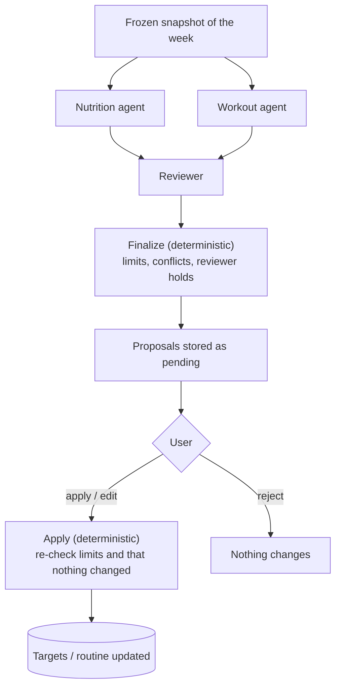

# Check-in agents

The weekly check-in is reviewed by three agents and then by fixed rules before the user
decides. A **Nutrition agent** and a **Workout agent** each look at their own part of the
week and propose changes; a **Reviewer** looks at both proposals together; deterministic
validation then holds every value to product limits. Nothing changes until the user
applies a proposal.

Code: `backend/app/coach/agents/`. The design follows [`plan.md` §9](plan.md#9-multi-agent-architecture);
where it differs, that's noted below.

## The flow

It's a LangGraph `StateGraph` (`graph.py`): Nutrition and Workout run in parallel, the
Reviewer runs once both are done, and `finalize` turns the result into proposals. The
graph ends there; the user's decision goes through the proposals API, not the graph.

## Input: the snapshot

When a check-in starts, the backend checks there's enough data (food logged on at least 4
of the last 7 days, at least 2 weigh-ins) and freezes the week into the check-in's
`input_snapshot`. The agents only ever see this snapshot: they never query the database,
and a run can be reproduced from it later.

The snapshot holds figures, not raw logs: average intake, the calorie target and its
version, logging completeness, the trend-weight change against the goal rate, workouts
done against planned, average RPE, the scheduled routines with each exercise's working-set
targets, and per-exercise trends (best estimated 1RM and average working-set RPE this week
against the three weeks before). No names, emails or other personal details are in it, so
none would reach a model provider.

## The agents

Each agent gets instructions (in `graph.py`), a compact JSON context, and a strict output
schema (`schemas.py`). Output that doesn't parse, or has fields the schema doesn't know, is
rejected.

| Agent | Sees | Returns |
|---|---|---|
| **Nutrition** | Calorie target, average intake, logging completeness, gap to target, weight change against the goal rate, goal | `keep` or `change` with a new calorie target, a headline, evidence, and what the data can't tell |
| **Workout** | Workouts done and planned, average RPE, scheduled routines with their targets, per-exercise trends, equipment | `keep` or `change` with adjustments (routine, exercise, field, new value, reason), headline, evidence |
| **Reviewer** | Both proposals, each training change next to the value it replaces, missing days, RPE, weight change against the goal | Findings (info, warning or conflict), whether to keep each proposal, and a note for the user |

Each agent sees only its own slice: the Nutrition agent never sees routines, the Workout
agent never sees calories. The Reviewer can **hold a proposal back** but can't add or
enlarge one.

## Deterministic checks

`finalize` and `validate.py` decide what may actually be proposed, whatever the agents
said. Values past a limit are clamped to it, with a note the user sees in the reviewer's
note; changes that refer to something the user doesn't have are dropped.

| Rule | Limit (`limits.py`) |
|---|---|
| Calorie target change per check-in | at most ±300 kcal, rounded to 50 kcal, never past the limit |
| Calorie target range | 1,000–6,000 kcal |
| Working sets per check-in | ±1, between 1 and 10 |
| Target weight per check-in | ±10%, in 2.5 kg steps; a weight too light for a step inside 10% is left alone |
| Target reps per check-in | ±3, between 1 and 30 |
| Training changes per check-in | at most 6, only for exercises in the user's scheduled routines |
| **Conflict** | When the calorie target goes down, training increases are held back in the same check-in: eating less while training harder undercuts recovery. |

Order matters: the reviewer's holds apply first, then the conflict rule, so a cut the
reviewer held back doesn't also hold back training.

The same limits apply again when the user **applies** a proposal, edited or not
(`training_change_error`, and the nutrition checks in `CoachService`). On top of that,
applying is refused (409) when what the proposal was based on has changed: the targets
have a newer version, or the routine was saved again since the check-in. All of a
proposal's changes are applied, or none.

**Applying a training change** keeps the sets' shape: a new target weight sets the
heaviest working set and scales the others in proportion (rounded towards their own
weight, so no set moves more than the whole); new reps move every working set by the same
number; more sets copy the last working set, fewer drop the last ones. Warm-ups and
failure or drop sets aren't touched (`backend/app/workout/targets.py`).

## When things go wrong

| Failure | What happens |
|---|---|
| Output that doesn't fit the schema | Asked for once more; then that agent is given up on. Its proposal is absent, the other agent's still stands, and its step shows as failed. |
| Transient model error (`ModelUnavailableError`: timeout, rate limit) | LangGraph retries the step, up to 3 attempts in all, with backoff. |
| An agent keeps failing, or another error | The run fails: the check-in is marked `failed` with a plain reason, nothing is changed, and the user can start again. Internal details go to the logs only. |
| A step takes too long | 60 s per step, 120 s for the whole run; then it fails as above. |
| No review | If the Reviewer's output is unusable, the deterministic rules still apply and its step shows as failed. |
| Server restarts mid-run | Every step is checkpointed under the check-in's id (PostgreSQL in deployment). At start-up, each `running` check-in continues from its last finished step once its original run would have timed out (so a live task elsewhere isn't doubled up); finished agents aren't run again. |
| Run lost for good | A check-in still `running` 10 minutes after it started is marked `failed` when it's next read, started over or resumed. |
| A late or duplicate run | Its result is written only if the check-in is still `running`, so it can't overwrite anything. |

## The model

Agents reach a language model through one interface (`model.py`): `generate(task)` gets
the agent's role, instructions, context and output schema, and returns raw structured
output (a JSON object or text), which the caller validates.

`COACH_MODEL_PROVIDER` picks one of two:

- **`openai`** (`OpenAICoachModel`): OpenAI's Chat Completions API, model `OPENAI_MODEL`
  (default `gpt-5.4-mini`), key `OPENAI_API_KEY` (the app refuses to start without one).
  The instructions go as the system message, the context as JSON, and the output schema as
  a non-strict `json_schema` response format: strict mode accepts only part of JSON Schema,
  and every answer is validated against the full schema anyway. Timeouts, connection
  errors, rate limits and 5xx become `ModelUnavailableError` and are retried by LangGraph
  (the client itself doesn't retry; one call times out after `OPENAI_TIMEOUT_SECONDS`,
  default 20, so a retry fits in the step's 60 s). A bad key or request fails the run.
  A refusal or a cut-off answer counts as unusable output and is logged.
- **`fake`** (`FakeCoachModel`, the default): answers in the shape a language model would,
  from simple rules, so the whole flow, validation and approval run without an API key.
  Tests, CI and the end-to-end tests always use it:

- **Nutrition:** keeps the target when under 80% of days were logged (and says so) or when
  the weight trend is within 0.15 kg/week of the goal; otherwise corrects the target by
  the intake gap plus about 1,100 kcal per kg/week the trend is off.
- **Workout:** for each scheduled exercise with a target weight, eases it 5% when working
  RPE is 9 or more and estimated 1RM hasn't improved; adds 2.5 kg when RPE is 7.5 or less
  and it's still improving. At most three changes.
- **Reviewer:** flags a cut alongside any load increase as a conflict and holds the
  training proposal; warns when more than two days have no food logged.

**Another provider** is one more class with the same `generate` method, like
`OpenAICoachModel`, selected by a new `COACH_MODEL_PROVIDER` value. The graph, the
validation and the retries stay as they are.

## Differences from the plan

- **No interrupt for approval.** The plan had the graph pause on a LangGraph interrupt
  until the user decides. Here the graph ends once proposals are stored, and the decision
  is ordinary database state through an idempotent API. Nothing waits in a checkpoint for
  days, and checkpoints are deleted when a run ends.
- **No Supervisor/Router.** The weekly check-in always runs the same agents, so there is
  nothing to route. Intent routing belongs with Coach Chat, which isn't built.
- **No "request changes" loop.** The user can edit values or reject, then start a new
  check-in; asking the agents to revise a proposal isn't built.
- **No exercise substitution.** Training proposals change sets, weight and reps of the
  routine's own exercises, never swap an exercise.

## Tests

`backend/tests/test_coach_agents.py` covers the agents with a scripted model:

- **Inputs:** each agent sees only its own context.
- **Outputs:** one run produces both kinds of proposal.
- **Reviewer:** catches a cut with a load increase; can hold back but not add.
- **Conflict rule:** holds even when the Reviewer misses the conflict.
- **Structured output:** invalid output is retried once then dropped; extra fields are refused.
- **Retries:** transient errors are retried, and a model that stays down fails the run.
- **Resume:** an interrupted run resumes from its checkpoint without redoing finished steps.
- **Insufficient data:** too little data gives no change rather than an invented one.
- **Limits:** every value is clamped as in the table above.

`backend/tests/test_coach_openai.py` covers the OpenAI provider against a stand-in client:
what it sends, a whole check-in run on it, which errors are retried, and that it needs a key.

`backend/tests/test_coach_api.py` covers the whole check-in through the API:

- **Background run:** generation in the background, failures and timeouts, interrupted runs and shutdown.
- **Real logs:** a training proposal comes out of actual logged workouts.
- **Applying:** proposals are applied to targets and routines, with their limits and 409s.
