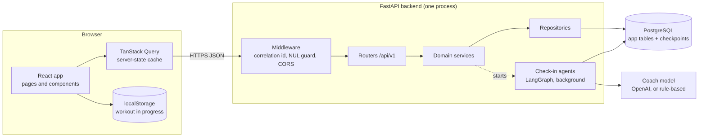
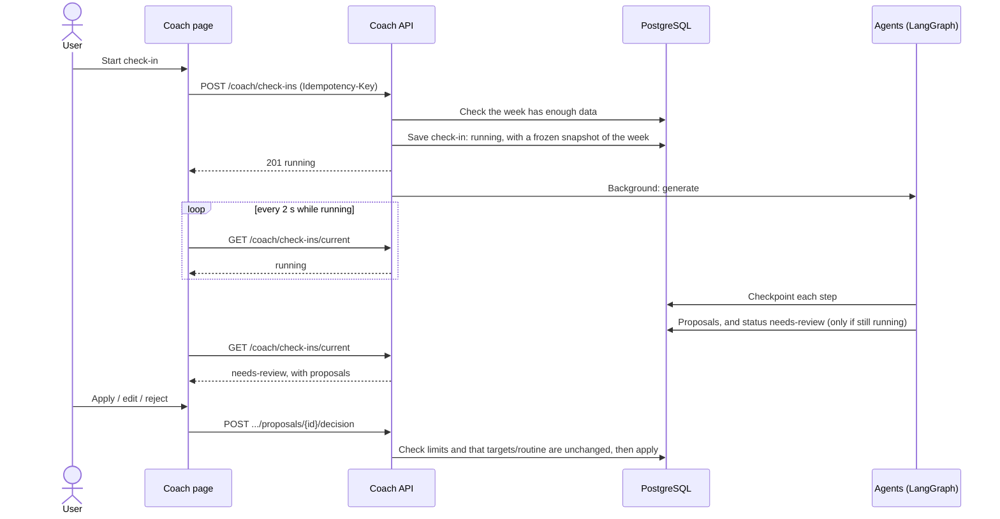

# Architecture

MacroRep is a React single-page app talking to a FastAPI backend over a versioned REST API
(`/api/v1`), with PostgreSQL behind it. The backend is a **modular monolith**: one
deployable process, split into domain modules that each own their tables. The weekly
check-in's agents run inside the same process as a LangGraph flow.

Related: [database design](database.md), [check-in agents](agents.md),
[deployment](deployment.md), and the original brief in [`plan.md`](plan.md).

## System overview

## Frontend

React 19 + TypeScript, built with Vite, styled with Tailwind and shadcn/ui components.
Installable as a PWA (`vite-plugin-pwa`); the service worker caches the built app only,
never API responses.

| Page | Route | Purpose |
|---|---|---|
| Sign-up guide | `/welcome` | A new account's first stop: profile, today's weight, goal, training, activity, equipment and starting targets (estimated from those details), saved together. The app's pages wait until it's done |
| Home | `/` | Today's calories and macros, today's workout, weight trend, check-in banner |
| Food | `/food` | Daily food log by meal; search, quick add, custom foods |
| Workout | `/workout` | Start a routine or an empty workout; live logging with rest timer and pause |
| History | `/workout/history` | Logged workouts; edit or delete one |
| Plan | `/workout/plan` | Routines, and the weekly schedule that assigns them to days |
| Coach | `/coach` | The weekly check-in: proposals to apply, edit or reject |
| Progress | `/progress` | Weight trend, adherence, volume, strength, check-in history |
| Profile | `/profile` | Profile, daily targets and their history |

How it's organised (`frontend/src`):

- `api/`: one module per backend area, all through one Axios client (`api/client.ts`)
  that attaches the access token and refreshes it on a 401.
- `hooks/`: TanStack Query hooks; mutations invalidate the queries they affect.
- `lib/`: pure logic with its own tests, e.g. the live workout reducer
  (`workout-session.ts`), the workout clock, and the proposal edit limits.
- `components/` and `pages/`: UI. Forms use React Hook Form with Zod schemas that mirror
  the backend's limits.

**State.** Server data lives in the TanStack Query cache. The one piece of client-only
state that matters is the workout in progress: kept in `localStorage`, so it survives a
reload or closing the tab, and synced across tabs. It's posted to the server only when
finished.

**Authentication.** The access token (short-lived JWT) is held in memory only. The refresh
token is an httpOnly, `SameSite=Strict` cookie scoped to `/api/v1/auth`, so page scripts
can never read it; on start-up the app asks the server whether the cookie is still good.

## Backend

FastAPI with async SQLAlchemy 2 (psycopg), Pydantic schemas, Alembic migrations.

### Modules

Each module under `backend/app/` follows the same layout: `models.py` (tables),
`schemas.py` (API contracts), `repository.py` (queries, always scoped to the owner),
`service.py` (rules), `router.py` (HTTP).

| Module | Owns | Responsibilities |
|---|---|---|
| `auth` | (users' password and refresh-token columns) | Register, log in, refresh-token rotation, log out |
| `identity` | `users` | Resolves the current user from the bearer token |
| `profile` | `profiles`, `nutrition_targets` | Profile, timezone, versioned daily targets |
| `food` | `foods`, `food_entries` | Food catalog and the daily food log |
| `body` | `weigh_ins` | Weigh-ins and the trend weight |
| `workout` | `exercises`, routines, schedule, sessions, sets | Exercise catalog, routines, weekly schedule, logged workouts |
| `progress` | (none: reads the others) | Dashboard figures, and the week's data a check-in needs |
| `coach` | `coach_check_ins`, `coach_proposals`, `coach_messages` | Check-ins, the agents, proposal decisions |
| `analytics` | (none) | Pure, tested formulas: adherence, trend weight, e1RM, volume, RPE |
| `health` | (none) | Liveness and readiness probes |

Modules call each other through repositories and services, never through HTTP. `progress`
is a read model over the other modules' tables, so dashboard queries aren't scattered as
special cases across every module.

### Request path

1. **Middleware**: binds a correlation id (from `X-Correlation-ID` or a new one) to the
   request's logs and response; refuses a NUL byte in the URL with a 400; CORS.
2. **Router**: validates the body and query against Pydantic models with an allow-list
   (unknown fields refused, every number range-checked, text trimmed and bounded).
   Validation errors return `{"message", "detail"}` without echoing the input.
3. **Identity**: the bearer token is verified and the user resolved. Every repository
   query is scoped to that user's id, so another user's data reads as not found (404).
4. **Service**: the domain rules, in one transaction per request.

### Dates and time zones

Timestamps are stored in UTC. Food entries and weigh-ins carry the user's **local**
calendar date. The profile holds the user's IANA time zone, kept in step with the browser,
which decides the user's "today" and which day a workout belongs to
(`backend/app/shared/timezones.py`).

## The weekly check-in

The check-in is the one long-running operation. Starting one answers immediately; the
proposals are generated in the background and the client polls until they're ready.

What makes it dependable:

- **Idempotent start**: retrying with the same `Idempotency-Key` returns the same
  check-in rather than making another.
- **Frozen snapshot**: the agents see the week's figures as they were when the check-in
  started, so the result is reproducible and auditable after logs change.
- **Conditional writes**: a run only writes its result while the check-in is still
  `running`, so a duplicate or very late run can't overwrite anything.
- **Resumable**: each step is checkpointed. A run interrupted by a restart continues from
  its last step when the backend starts again. One still running 10 minutes after it
  started is marked `failed` the next time it's read, and the user can start again.
- **Nothing changes without the user**: generation only writes proposals. Applying one is
  a separate, explicit request, refused if the targets or routine changed since.

How the agents themselves work is in [agents.md](agents.md).

## Key decisions

| Decision | Why |
|---|---|
| Modular monolith, not services | One deployable for a four-person team; module boundaries keep ownership clear without network calls between them. |
| Agents in-process, no job queue | A check-in runs for seconds; a background task plus checkpoints covers restarts without running Redis or a worker. |
| Agents read a frozen snapshot, not the database | Reproducible runs, a clean audit record, and agents that can't run arbitrary queries. |
| Deterministic validation after the agents | The model interprets; code decides what may be proposed, within fixed limits. |
| Approval outside the graph | The decision is ordinary database state, not a paused graph waiting for days in a checkpoint. |
| Versioned targets, revisioned routines | Past days are judged against the target in effect then, and a proposal is refused once what it was based on has changed. |
| Refresh token in an httpOnly cookie, same-origin | Scripts can't read it, and `SameSite=Strict` is the CSRF defence. |
| Local dates for logs, UTC for timestamps | A meal belongs to the user's day, wherever the server is. |
