# Database

PostgreSQL 17 in every environment, the test suite included. The schema
is defined by the SQLAlchemy models in each backend module (`backend/app/*/models.py`)
and created by Alembic migrations (`backend/migrations/versions`).

## Entity–relationship diagram

Every table except the shared catalogs belongs to one user. Primary keys are strings:
`USR-…` for users, UUID hex for everything else. Timestamps are UTC (`created_utc`,
`updated_utc` on most tables, omitted below).

```mermaid
erDiagram
    users ||--o| profiles : has
    users ||--o{ nutrition_targets : "versions of"
    users ||--o{ weigh_ins : logs
    users ||--o{ food_entries : logs
    users ||--o{ foods : "custom foods"
    foods |o--o{ food_entries : "logged from"
    users ||--o{ exercises : "custom exercises"
    users ||--o{ workout_plan_entries : "routines"
    workout_plan_entries ||--o{ workout_plan_exercises : contains
    exercises ||--o{ workout_plan_exercises : "used in"
    users ||--o{ workout_schedule_days : schedules
    workout_plan_entries ||--o{ workout_schedule_days : "scheduled on"
    users ||--o{ workout_sessions : logs
    workout_plan_entries |o--o{ workout_sessions : "started from"
    workout_sessions ||--o{ workout_set_logs : contains
    exercises |o--o{ workout_set_logs : "performed"
    users ||--o{ coach_check_ins : has
    coach_check_ins ||--o{ coach_proposals : proposes
    coach_check_ins ||--o{ coach_messages : "chat"
    coach_proposals |o--o{ nutrition_targets : "set by"

    users {
        string id PK "USR-..."
        string email UK
        string name
        string password_hash "Argon2"
        string refresh_token_hash "SHA-256 of the current token"
        datetime refresh_expires_at
        enum status
    }
    profiles {
        string user_id PK,FK
        string name
        numeric height_cm
        enum goal "lose / maintain / gain"
        numeric weekly_rate_kg
        enum experience_level
        string timezone "IANA name"
        timestamp onboarded_utc "null until the sign-up guide is done"
        date date_of_birth "null until the sign-up guide"
        enum sex "male / female"
        enum activity_level "sedentary / light / moderate / very"
    }
    nutrition_targets {
        string id PK
        string owner_id FK
        int version "unique per owner"
        date effective_date "user's local day"
        int calories
        numeric protein_g
        numeric carbs_g
        numeric fat_g
        enum source "initial / manual / check-in"
        string proposal_id FK "nullable"
    }
    weigh_ins {
        string id PK
        string owner_id FK
        date log_date "unique per owner"
        numeric weight_kg
    }
    foods {
        string id PK
        string owner_id FK "null = shared catalog"
        string name
        numeric serving_size
        enum serving_unit
        int calories
        numeric protein
        numeric carbs
        numeric fat
    }
    food_entries {
        string id PK
        string owner_id FK
        date log_date "user's local day"
        enum meal
        string name
        int calories
        numeric protein
        numeric carbs
        numeric fat
        string food_id FK "nullable"
        numeric quantity
    }
    exercises {
        string id PK
        string owner_id FK "null = shared catalog"
        string name
        enum equipment
        json muscles
    }
    workout_plan_entries {
        string id PK "a routine"
        string owner_id FK
        string name
    }
    workout_plan_exercises {
        string id PK
        string plan_entry_id FK
        string exercise_id FK
        int position
        int rest_seconds
        json planned_sets "kind, target weight, target reps"
    }
    workout_schedule_days {
        string id PK
        string owner_id FK
        int day_of_week "0 = Monday; unique per owner"
        string routine_id FK
    }
    workout_sessions {
        string id PK
        string owner_id FK
        string plan_entry_id FK "nullable"
        string name
        datetime started_at
        datetime finished_at
    }
    workout_set_logs {
        string id PK
        string session_id FK
        string owner_id FK
        string exercise_id FK "nullable"
        string exercise_name
        enum kind "warmup / working / failure / drop"
        numeric weight_kg
        int reps
        numeric rpe "nullable"
        int position
        int exercise_position
    }
    coach_check_ins {
        string id PK
        string owner_id FK
        enum status "running / needs-review / reviewed / failed"
        string idempotency_key "unique per owner"
        json input_snapshot "the week, frozen"
        text summary
        json stats
        json pipeline
        text failure_reason
    }
    coach_proposals {
        string id PK
        string check_in_id FK
        enum kind "nutrition / training"
        string headline
        json changes "as decided"
        json proposed_changes "as proposed"
        json evidence
        text reviewer_note
        enum status "pending / applied / edited / rejected"
        datetime decided_utc
    }
    coach_messages {
        string id PK
        string check_in_id FK
        string owner_id FK
        enum role
        text text
    }
```

`workout_plan_entries` is what the app calls a **routine**: the table kept its name from
when each weekday held its own plan.

## Design notes

**Ownership.** Every user-owned row leads to one user, and every repository query is
scoped to that user, so one user can't read or change another's rows. Most tables carry
`owner_id` with `ON DELETE CASCADE` to `users`; `profiles` is keyed by `user_id` itself;
`workout_plan_exercises` and `coach_proposals` have no owner column and are reached through
their routine and check-in, which do. `foods` and `exercises` hold both the shared catalog
(`owner_id` null) and a user's own custom items.

**Deletes.** Rows are hard-deleted by their owner; there is no soft delete. Where history
may outlive what it points to, the reference is `ON DELETE SET NULL` and the history keeps
a copy of what it needs: a logged set keeps `exercise_name`, a food entry keeps its name
and nutrients, and a workout keeps its sets when its routine is deleted. The exception is
an exercise a routine uses: `workout_plan_exercises.exercise_id` is `ON DELETE RESTRICT`,
so it can't be deleted while a routine holds it (the app has no way to delete an exercise
yet).

**Versioned targets.** Changing the daily targets never overwrites them: it adds a
`nutrition_targets` row with the next `version` and the local day it takes effect. A past
day is judged against the version in effect then, so changing a target today doesn't
rewrite last week's adherence. A check-in records the version its proposals were made
against; applying one is refused once a newer version exists.

**Routine revisions.** A check-in's snapshot records each routine's last-saved time.
Applying a training proposal is refused if the routine was saved again since.

**Audit trail of a check-in.** `input_snapshot` freezes the week's figures the agents saw;
each proposal keeps `proposed_changes` (exactly as proposed) next to `changes` (as the
user applied them), with its status and `decided_utc`; a target set by a check-in points
back at its proposal.

**Numbers.** Measured values use `NUMERIC` with a fixed scale (weights to 0.01 kg, macros
to 0.1 g) rather than floats. Every API input limit fits its column, so an oversized value
is a 422, never a database error.

**Dates.** Food entries, weigh-ins and target versions use the user's local calendar
date. Workout times and all other timestamps are UTC, placed on a day in the user's time
zone when read.

## Constraints and indexes

| Table | Constraint or index | Purpose |
|---|---|---|
| `users` | unique `email` | One account per email |
| `weigh_ins` | unique (`owner_id`, `log_date`) | One weigh-in per day |
| `nutrition_targets` | unique (`owner_id`, `version`) | Two concurrent changes can't both become the same version |
| `workout_schedule_days` | unique (`owner_id`, `day_of_week`) | One routine per weekday |
| `coach_check_ins` | unique (`owner_id`, `idempotency_key`) | A retried start can't create a second check-in |
| `food_entries` | (`owner_id`, `log_date`) | A day's log |
| `workout_sessions` | (`owner_id`, `started_at`) | History, newest first |
| `workout_set_logs` | (`owner_id`, `exercise_id`, `position`) | An exercise's previous sets and trends |
| `coach_check_ins` | (`owner_id`, `created_utc`) | The current check-in |
| `foods`, `exercises` | (`owner_id`, `name`) | Search |

## Check-in checkpoints

LangGraph's PostgreSQL checkpointer keeps its own tables: `checkpoints`,
`checkpoint_blobs`, `checkpoint_writes` and `checkpoint_migrations`. They are created by
the checkpointer at backend start-up (not by Alembic), keyed by the check-in id as the
thread id, and a run's rows are deleted once it finishes. See [agents.md](agents.md).

## Migrations

Applied in this order (`backend/migrations/versions`):

| Revision | Change |
|---|---|
| `d6e2f5bdaa4f` | Initial schema |
| `a1f4c9e2b7d3` | Local passwords and refresh tokens |
| `97369351f1f6` | Profile equipment and experience; set RPE |
| `c3b8e1f7a2d9` | Check-in idempotency key and input snapshot |
| `e5a9d2c4f1b6` | Food entry linked to its food, with a quantity |
| `f7c3a8d1e2b4` | Profile time zone |
| `a8d4c2e6b9f1` | Exercise order within a logged workout |
| `b4e7c1a9d2f8` | Failure and drop set kinds |
| `c9d2e5f8a1b3` | Routines and the weekly schedule (existing day plans become routines) |
| `d1f4a7b2c8e5` | Versioned nutrition targets (moved off `profiles`) |
| `e3b6c9f2d4a7` | Check-in running/failed states; proposals keep proposed values and decision time |
| `c4f8a2d6e9b1` | Clears the placeholder Coach Chat replies |
| `d7a3e5c1f8b2` | Proposal revisions from Coach Chat; message kinds |
| `e8b4f2a6c3d9` | Food entries from a meal photo |
| `f9c5a3b7d1e4` | When the profile finished the sign-up guide (existing profiles count as done) |
| `a2d6f8c4e1b7` | Profile birth date, sex and activity level, for estimating starting targets |
| `b3e7a9d5c2f1` | Drops a food's brand, fibre, sugar and sodium, which nothing used |
| `c4f9b2e8a6d3` | Drops training days per week: the weekly schedule says which days the user trains |
| `d5a1c7e3f9b4` | Drops the user's equipment, which nothing used (exercises keep theirs) |
| `e6c2a8f4b1d7` | Installs the common built-in exercise catalog without replacing existing rows |
| `f7d3b9a5c1e8` | Drops a routine's week label and typed-in time (the time is worked out from its sets) |

Run `uv run alembic upgrade head` from `backend/`. CI runs every migration on PostgreSQL,
then downgrades and upgrades again.
