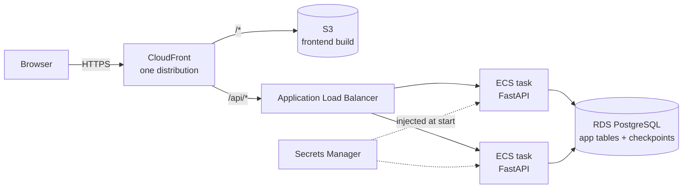
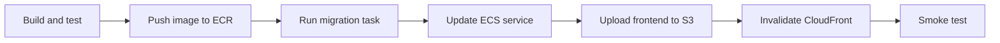

# Deployment

How MacroRep would be deployed, and what that needs. **The project is not deployed**:
this is the design and the checklist, written so the deployment could be done from it.
The target is AWS, as decided in [`plan.md` §22](plan.md#22-cicd-and-deployment); this
document turns that section into steps and adds what the code needs since it was written.

## What gets deployed

| Piece | What it is | Where it runs |
|---|---|---|
| Frontend | React single-page app, built to static files by `npm run build` (`frontend/dist`) | S3 bucket behind CloudFront |
| Backend | FastAPI app in one container (`backend/Dockerfile`, `production` stage) | ECS on Fargate, behind an Application Load Balancer |
| Database | PostgreSQL 17: application tables, plus LangGraph's checkpoint tables | RDS for PostgreSQL |
| Migrations | `alembic upgrade head`, the same backend image | A one-off ECS task, run before each backend release |

The check-in agents run inside the backend process (a background task per check-in), so
there is no separate worker or queue. No object storage is needed yet: nothing stores
files (food-photo analysis, which would, isn't built).

## Topology

Frontend and API are served from **one CloudFront distribution**, so the browser sees a
single origin. That's required, not a preference: the refresh token is an httpOnly
cookie with `SameSite=Strict` scoped to `/api/v1/auth`, which only works same-origin
(details and the CloudFront behaviour settings are in [`plan.md` §22](plan.md#why-one-cloudfront-distribution)).
The frontend is built with `VITE_API_BASE_URL=/api/v1`, a relative path.

## Before the first deployment

These need doing once, by hand or in infrastructure code (none exists yet):

1. **Network.** A VPC with public subnets for the ALB and private subnets for the ECS
   tasks and RDS. The ALB accepts traffic only from CloudFront (the AWS-managed
   CloudFront prefix list); RDS accepts connections only from the tasks' security group.
2. **RDS PostgreSQL 17**, encrypted, automated backups with point-in-time recovery on.
3. **Secrets Manager** entries for `DATABASE_URL` and `JWT_SECRET_KEY` (see below).
4. **ECR repository** for the backend image.
5. **ECS cluster, task definition and service**, with the target group's health check on
   `/health/ready`.
6. **S3 bucket** (private, versioning on) and the **CloudFront distribution** with two
   behaviours: `/api/*` to the ALB (caching disabled, all viewer headers forwarded,
   HTTPS-only to the origin) ordered before `/*` to S3.
   The app's own routes (`/coach`, `/workout/plan`, …) have no object in the bucket, so a
   first visit or a refresh there must still get `index.html`. Attach a CloudFront
   Function to the `/*` behaviour only that rewrites any path without a file extension to
   `/index.html`. Don't use the distribution's custom error responses for this: they apply
   to every behaviour and would turn the API's real 403 and 404 answers into a 200 page.
7. **Security response headers** on CloudFront (a response headers policy): CSP, HSTS,
   `X-Content-Type-Options: nosniff` and `Referrer-Policy`. These were deliberately left
   until the real origins are known; the backend sets none. The CSP for the production
   bundle needs no `unsafe-inline`/`unsafe-eval` (only the dev server does).

## Configuration

The backend reads everything from environment variables (`backend/app/core/config.py`,
example values in `backend/.env.example`). It refuses to start in production with unsafe
values, so a misconfiguration fails fast instead of running.

| Variable | Production value | Notes |
|---|---|---|
| `APP_ENV` | `prod` | Turns on the startup checks below. |
| `DATABASE_URL` | **secret** | `postgresql+psycopg://…`. The checkpointer derives its own connection from it. |
| `JWT_SECRET_KEY` | **secret** | Must be the **same for every task**; startup refuses the local default. |
| `REFRESH_COOKIE_SECURE` | `true` | Required in production. |
| `REFRESH_COOKIE_SAMESITE` | `strict` | Same-origin topology, so no CSRF tokens are needed. |
| `REFRESH_COOKIE_PATH` | `/api/v1/auth` | The default. |
| `CORS_ORIGINS` | `[]` or the CloudFront URL | Same-origin requests don't need CORS. |
| `PREVIEW_AUTH_ENABLED` | `false` | Required in production (it's a local testing shortcut). |
| `AUTO_CREATE_SCHEMA` | `false` | Required in production: the schema comes from Alembic. |
| `SEED_DEMO_DATA` | `false` | Required in production. For a demo environment, see below. |
| `DEBUG` | `false` | Required in production. |
| `DATABASE_POOL_SIZE`, `DATABASE_MAX_OVERFLOW` | e.g. `5`, `5` | Per task. See the connection budget. |
| `COACH_MODEL_PROVIDER` | `openai` | Or `fake` (rule-based) for a demo without a key. |
| `OPENAI_API_KEY` | from Secrets Manager | Required with `openai`. |
| `OPENAI_MODEL` | `gpt-5.4-mini` | The default. |
| `OPENAI_REASONING_EFFORT` | `low` | The default; empty for a model without reasoning. |
| `LOG_JSON` | `true` | One JSON object per line, for CloudWatch. |
| `LOG_LEVEL` | `INFO` | |
| `LOG_DIR` | unset | Log files are for local development; a container's logs are collected from stdout. |

For a **demo** environment that should come with the seeded demo account, the app has to
run with `APP_ENV=local`, since production refuses `SEED_DEMO_DATA=true`. That also turns
off every production start-up check, so on anything reachable from the internet set these
yourself, all of them:

- `PREVIEW_AUTH_ENABLED=false`. It defaults to on outside production, and lets anyone act
  as the demo user by sending its fixed id in a header.
- `JWT_SECRET_KEY` to a private value. The local default is public in this repository, so
  anyone could sign tokens for any user with it.
- `REFRESH_COOKIE_SECURE=true`, `DEBUG=false`, `AUTO_CREATE_SCHEMA=false`.

Safer still: deploy with `APP_ENV=prod` and create the demo account through the normal
sign-up, then log its demo data by hand or with a script.

### Connection budget

Each backend task opens up to `DATABASE_POOL_SIZE + DATABASE_MAX_OVERFLOW` connections for
requests, **plus up to 2** for the LangGraph checkpointer's own pool
(`backend/app/coach/agents/checkpoint.py`). On `db.t4g.micro` (about 112 connections)
the defaults (10 + 20 + 2 = 32 per task) run out at four tasks. Lower the pool settings,
or put RDS Proxy in front, before raising the service's maximum task count.

## Releasing

1. **Build and test.** A green CI run (`.github/workflows/ci.yml`) for the commit being
   released: backend lint, type check, the migrations on PostgreSQL, and the tests on
   PostgreSQL and SQLite; frontend lint, type check, tests and a build with
   `VITE_API_BASE_URL=/api/v1`; and the end-to-end tests against both on PostgreSQL.
2. **Push the backend image** (`docker build --target production -f backend/Dockerfile .`),
   tagged with the commit SHA. Never deploy `latest`.
3. **Migrate.** Run the new image once as an ECS task with the command
   `alembic upgrade head`, and wait for it to succeed. Migrations never run in the
   service's own command: every scaled task would race the same DDL. (The
   `alembic upgrade head && uvicorn` chain in `compose.yaml` is for local use only.)
4. **Update the ECS service** to the new task definition. A rolling update keeps old tasks
   serving until the new ones pass `/health/ready`.
5. **Upload the frontend build** to S3 (`dist/` contents). Only `assets/*` have hashed
   names and can be cached long. Everything at the top level of `dist/` keeps its name
   between releases (`index.html`, the service worker `sw.js` and `workbox-*.js`,
   `registerSW.js`, `manifest.webmanifest`, the icons) and needs a short cache lifetime.
6. **Invalidate CloudFront** for those unhashed files: `/index.html`, `/sw.js`,
   `/registerSW.js`, `/manifest.webmanifest`.
7. **Smoke test** `GET /api/version` through the CloudFront URL, which proves the
   `/api/*` route reaches the backend, then sign in with a test account. The health
   endpoints live outside `/api` (`/health/live`, `/health/ready`), so CloudFront sends
   them to S3; check them on the load balancer instead (the target group already does).

### Check-ins running during a release

A check-in's proposals are generated in the background, inside a backend task. When ECS
stops a task, the app cancels its runs before closing the database pools, and if the task
is killed before it gets that far the effect is the same: each run stays `running`, with
its finished steps checkpointed in PostgreSQL. A task that starts takes over `running`
check-ins and continues each from its last checkpoint, so a release doesn't fail
check-ins in progress.

A `running` check-in may still belong to a live task (the old tasks keep serving during a
rolling update). A run can't last longer than 120 seconds, so a starting task waits until
that has passed since the check-in began before taking it over; by then a live owner has
finished it or failed it, and only a run whose task died is still waiting. If two tasks
start at once they may both take over the same dead run: writes are conditional on the
check-in still running, so only one result is kept, and the cost is duplicate model calls.

A check-in still `running` 10 minutes after it began is treated as lost and marked
`failed`, so the user can start another. Nothing sweeps for these: the check is made when
the check-in is next read (the Coach page polls it), when a new one is started, or when
a task tries to resume it.

### LangGraph checkpoint tables

On startup against PostgreSQL the backend creates LangGraph's tables if missing
(`checkpoints`, `checkpoint_blobs`, `checkpoint_writes`, `checkpoint_migrations`). They are
managed by LangGraph, not Alembic, and stay small: a run's checkpoints are deleted when it
finishes or fails.

## Rollback

- **Backend:** point the ECS service back at the previous task definition (the previous
  image tag). Schema changes are written to be compatible with the code one release back
  where possible; otherwise roll forward with a fix.
- **Database:** every migration has an `alembic downgrade` except `c9d2e5f8a1b3`
  (routines and weekly schedule), which refuses because a routine scheduled on several
  days can't be turned back into one plan per day. Downgrading `e3b6c9f2d4a7` turns its
  `running` and `failed` check-ins into `reviewed`, which older code can read. Downgrading
  `b4e7c1a9d2f8` is **not safe once a failure or drop set has been logged**: PostgreSQL
  can't drop the enum values, and older code fails to read those sets. Take a manual RDS
  snapshot before running migrations, and restore from it rather than downgrade in that
  case, or when a downgrade isn't possible.
- **Frontend:** restore the previous object versions in S3 and invalidate CloudFront.

## Operations

- **Health checks:** `/health/live` (process up) for the container, `/health/ready` (runs
  `SELECT 1`) for the load balancer.
- **Logs:** JSON lines to CloudWatch Logs via the `awslogs` driver. Each request carries an
  `X-Correlation-ID` (generated if the client doesn't send one) that appears in its logs;
  check-in runs log their check-in id. Request bodies aren't logged, and fields named like
  credentials (authorization, cookie, password, token, secret) are redacted
  (`backend/app/shared/logging.py`).
- **Alarms worth having:** ALB 5xx rate, target response time, unhealthy host count, RDS
  CPU and free storage, check-ins marked `failed` per day, and check-ins still `running`
  more than 10 minutes after they started (a query: those haven't been marked yet).
- **Backups:** RDS automated backups with point-in-time recovery; S3 versioning on the
  frontend bucket.

## Cost

The always-on pieces dominate: Fargate task hours, the ALB's hourly charge and the RDS
instance. S3 and CloudFront are negligible at this scale. Keep the service at one task
outside demos, and confirm the monthly figure with the AWS Pricing Calculator before
creating anything. A model provider's API calls would add a per-check-in cost.

## Not ready for production yet

Gaps that would matter for real users, tracked in [`follow-ups.md`](follow-ups.md):

- **Sign-in limits count per task, by the connecting address.** `app/shared/rate_limit.py`
  keeps its counts in memory, so with two tasks an account gets twice the attempts. And
  behind CloudFront and the ALB the connecting address is the ALB's, so every user would
  share one count. The client's own address has to be passed through: have CloudFront send
  its `CloudFront-Viewer-Address` header to the origin and read that, or run uvicorn with
  `--proxy-headers` trusting both the ALB's and CloudFront's address ranges. For more than one
  task, move the counts to a shared store (Redis) or use an AWS WAF rate-based rule on the
  distribution instead.
- **No infrastructure code or deploy pipeline.** CI is step 1 of releasing and builds the
  image, but pushes nothing; the other steps are manual.
